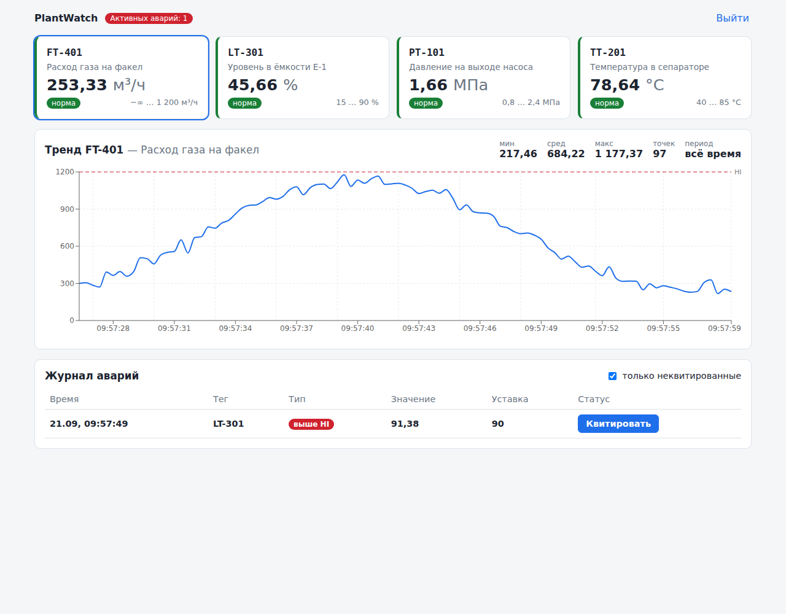

# PlantWatch Web

Веб-интерфейс оператора для [plantwatch-api](https://github.com/MegaMishka/plantwatch-api): карточки датчиков с текущими значениями и состоянием относительно уставок, тренд выбранного параметра с линиями HI/LO, журнал аварий с квитированием.



## Стек

- **React 19** + **TypeScript** (`strict: true`), сборка **Vite**
- Recharts — графики трендов
- **Vitest** + React Testing Library — 30 тестов (API-клиент, хук опроса, бизнес-логика, компоненты, сценарий истечения сессии)
- oxlint, GitHub Actions (lint → test → build)

## Что внутри

- `src/api/client.ts` — типизированный клиент REST API: JWT в заголовке `Authorization`, разбор ошибок FastAPI (`detail`, в т.ч. 422). При 401 клиент оповещает подписчиков, и приложение возвращает пользователя на экран входа с сообщением «Сессия истекла».
- `src/hooks/usePolling.ts` — свой хук периодического опроса API:
  - следующий запрос уходит только после завершения предыдущего — при медленном сервере запросы не копятся;
  - каждый запрос нумеруется, записывается только самый свежий ответ — нет гонок при переключении датчика;
  - при смене источника старые данные сразу скрываются, чтобы под заголовком нового датчика не мелькал чужой тренд.
- Текущие значения всех датчиков приходят одним запросом `GET /sensors` (без N+1 запросов с клиента).
- Квитирование: кнопка блокируется на время запроса, ошибки (например, 409 — уже квитировал другой оператор) показываются пользователю.
- Recharts вынесен в отдельный чанк (`React.lazy`), основной бандл ~73 kB gzip.
- `src/lib/format.ts` — логика состояний «норма / близко к уставке / авария» и форматирование чисел по-русски.
- Адаптивная вёрстка и тёмная тема через CSS-переменные, без UI-библиотек.

## Запуск

```bash
npm install
npm run dev          # http://localhost:5173, запросы /api проксируются на http://localhost:8000
npm test
npm run build
```

Бэкенд и эмулятор датчиков поднимаются по инструкции в plantwatch-api.

## Известные ограничения и что дальше

- JWT хранится в `localStorage` — просто для демо, но уязвимо к XSS; в продакшене — httpOnly-cookie.

- WebSocket вместо опроса;
- форма создания датчика и редактирования уставок;
- выбор периода тренда и экспорт в CSV.
